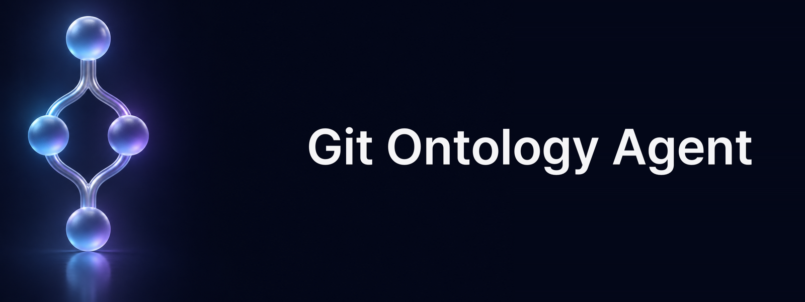

<div align="center">



<p>
  <a href="https://github.com/gogoymh/git-ontology-agent/stargazers"></a>
  <a href="https://github.com/gogoymh/git-ontology-agent/actions/workflows/ci.yml"></a>
  <a href="LICENSE"></a>
  
  
</p>

<p>
  <a href="#quick-start">Quick start</a> ·
  <a href="#see-it-in-action">Demo</a> ·
  <a href="#how-it-works">How it works</a> ·
  <a href="#providers">Providers</a> ·
  <a href="#the-ontology">Ontology</a> ·
  <a href="#git-is-the-audit-log">Audit log</a>
</p>

</div>

**Git Ontology Agent** (`goa`) lets you keep talking while your agent is still working.

Most agents handle one message at a time. Say something mid-task and they ignore it, throw away the work and restart, or mix two answers together. GOA treats **each request as a git branch** and **answers by merging**:

- 💬 **Interim answers, right away.** A follow-up gets an answer from the branch as it is *now*: what's decided, how your new message is applied, what's left.
- 🧭 **Redo only what changed.** Work is stored as typed claims with `depends_on`. A new budget redoes the hotel, not the train.
- 🔀 **Merges that understand meaning.** A claim-level 3-way merge with per-type rules settles almost every conflict. What's left goes to a decision model, or back to you.
- 🧾 **Every sentence has a source.** Each claim, judgment and answer is a commit with trailers. "Why did it say that?" is a `git log` away.

```text
git       knows when, who and what changed.
ontology  knows what depends on what, and how to merge it.
```

## Quick start

```bash
pip install git+https://github.com/gogoymh/git-ontology-agent
goa demo                      # replays the spec example offline: no API key needed
```

Then chat for real, with any LLM and any decision model:

```bash
export OPENAI_API_KEY=... TYPESAFE_API_KEY=...
goa chat --llm openai --decision typesafe
goa log                       # the conversation as a git graph
```

Python 3.9+, zero dependencies, standard library only. Answers follow your system language (`--lang ko`, `--lang en`, ...).

## See it in action

You ask for a trip plan, add a budget while it works, then ask something unrelated. Real output of `goa demo --lang en`:

```text
R1 Plan my Busan business trip next week

R2 Oh, keep the budget under 500,000 won
  interim KTX is set: Tue 08:00 KTX (Seoul→Busan). Applying the budget of ₩500,000
          you mentioned, I'm redoing the hotel candidates, hotel and total.
          ↳ from req/1@9f21c9b k1 supplement

R3 By the way, what time is tomorrow's meeting?
  interim Tomorrow's meeting is at 2:00 PM. Still working on the Busan trip plan.
          ↳ from main@c8e68fb k3 independent
  final   Here is your plan: Tue 08:00 KTX (Seoul→Busan) → Hotel A (2 nights, ₩180,000)
          → total ₩460,000 (within the ₩500,000 budget). The budget (₩500,000) came
          from your second request.
          ↳ from main@07ee839
```

And the repository it leaves behind:

```text
*   Merge req/1: Busan trip plan
|\
| * plan.total: decide (total ₩460,000 (within the ₩500,000 budget))
| * plan.hotel: decide (Hotel A (2 nights, ₩180,000))
| * hotel.candidates: redo (Hotel A)
| * constraint.budget: add (₩500,000)          ← R2, judged k1 supplement
| * hotel.candidates: find (Hotel C, Hotel B, Hotel A)
| * plan.train: decide (Tue 08:00 KTX (Seoul→Busan))
| * req.1: open (Plan my Busan business trip next week)
* |   Merge req/3: tomorrow's meeting          ← R3, independent, merged first
|\ \
| * | meeting.tomorrow: find (at 2:00 PM)
|/ /
* C0: empty conversation state
```

Two more scenarios from the spec: `goa demo --scenario correction` ("not Busan but Daegu": the city is retracted, every result that depended on it is redone) and `goa demo --scenario cancel` (a progress question changes nothing; "stop" closes the branch unmerged, history kept).

## How it works

Every message goes through the same six steps.

| # | Step | Engine | What happens |
| --- | --- | --- | --- |
| 1 | Open request? | git | No `req/*` branch open → branch from `main`, go to 4 |
| 2 | Relation | decision model | supplement · correction · independent · cancel · progress |
| 3 | Interim answer | LLM | Written from the branch head *at this moment* |
| 4 | Process | LLM + ontology | One claim commit per step; only dependents of a change are redone |
| 5 | Merge | git + decision model | Claim-level 3-way merge; type rules first, `noul` for the rest |
| 6 | Final answer | LLM | Written from merge commit `M`, base `C0..M`, with provenance |

The relation is one typed `choice`, with neutral keys so the model reads the definitions, not the names:

| Key | Relation | Example | Git |
| --- | --- | --- | --- |
| `k1` | supplement | "keep it under 500k" | commit a Constraint to the open branch, redo its dependents |
| `k2` | correction | "not Busan, Daegu" | retract the old claim, commit the new one, invalidate dependents |
| `k3` | independent | "what time is the meeting?" | new branch from `main`, runs in parallel, merges when done |
| `k4` | cancel | "stop, it's off" | close the branch unmerged (`cancelled/req/1`), history kept |
| `k5` | progress | "how far along?" | change nothing, report from the branch |

```jsonc
// what the agent sends Typesafe Jev
{ "model": "typesafe/jev-1.14",
  "state": { "in_progress": "R1: Plan my Busan business trip (claims: plan.train=Tue 08:00 KTX [confirmed], ...)",
             "new": "Oh, keep the budget under 500,000 won", "touches": ["Constraint"] },
  "questions": { "relation": { "type": "choice",
                               "instructions": "How does the new request relate to the request in progress?",
                               "criteria": { "k1": "It adds a condition or information ...", "k2": "...", "k5": "..." } } } }
```

If confidence is below `0.8`, the agent asks instead of guessing: *"Should I apply this to the Busan trip plan in progress, or handle it separately?"* With several requests open, a second `choice` picks which one the message is about. Thresholds live in `policy.yaml`, versioned in the same repo.

## Providers

Pick any LLM for work and answers, and any decision model for judgments. Mix freely: `--llm anthropic --decision openai`.

**LLMs** · `--llm provider[:model]`

| Provider | Flag | Key | Default model |
| --- | --- | --- | --- |
| OpenAI | `openai` | `OPENAI_API_KEY` | `gpt-5.1` |
| Anthropic | `anthropic` | `ANTHROPIC_API_KEY` | `claude-sonnet-5-5` |
| Google Gemini | `gemini` | `GEMINI_API_KEY` | `gemini-2.5-flash` |
| xAI | `xai` | `XAI_API_KEY` | `grok-4` |
| Meta Llama API | `meta` | `LLAMA_API_KEY` | `Llama-4-Maverick-17B-128E-Instruct-FP8` |
| OpenRouter | `openrouter` | `OPENROUTER_API_KEY` | `openrouter/auto` |
| Offline | `offline` | none | built-in demo skills and templates |

**Decision models** · `--decision provider[:model]`

| Provider | Flag | Key | How |
| --- | --- | --- | --- |
| Typesafe Jev | `typesafe` | `TYPESAFE_API_KEY` | native Jev API, `typesafe/jev-1.14` |
| OpenAI | `openai` | `OPENAI_API_KEY` | OpenAI Decisions API (`predicate` / `choice`), `gpt-6-luna` |
| Google Gemini | `gemini` | `GEMINI_API_KEY` | structured output with an enum schema, temperature 0 |
| Cloudflare | `cloudflare` | `CLOUDFLARE_ACCOUNT_ID`, `CLOUDFLARE_API_TOKEN` | Workers AI JSON-schema mode |
| Cloudflare Clef, Jev via gateway | `openrouter:cloudflare/clef` | `OPENROUTER_API_KEY` | OpenRouter Decisions API |
| AI/ML API | `aimlapi` | `AIMLAPI_API_KEY` | Jev-shape gateway |
| Any LLM | `llm:anthropic`, `llm:xai`, ... | that LLM's key | JSON-schema judgment |
| Offline | `local` | none | deterministic keyword + ontology heuristic |

Every backend returns the same typed answer (`choice` + `confidence` + `probabilities`, or `noul` in [0, 1]); values are clamped, and a refusal becomes confidence 0, which makes the agent ask.
Override models with `GOA_<PROVIDER>_MODEL` and endpoints with `TYPESAFE_URL`, `OPENAI_DECISIONS_URL`, `OPENROUTER_DECISIONS_URL`.

## The ontology

The work state is not prose. It is a list of typed claims in `state.yaml`, one per line:

```yaml
- {"id": "trip.city", "type": "Assumption", "value": "Busan", "from": "req.1", "status": "confirmed"}
- {"id": "constraint.budget", "type": "Constraint", "value": "₩500,000", "from": "req.2", "status": "confirmed"}
- {"id": "plan.train", "type": "Decision", "value": "Tue 08:00 KTX", "from": "req.1", "status": "confirmed", "depends_on": ["trip.city"]}
- {"id": "hotel.candidates", "type": "Finding", "value": "Hotel C, Hotel B, Hotel A", "from": "req.1", "status": "invalid", "depends_on": ["trip.city", "constraint.*"]}
```

**Merge rules by type.** Git only says "both sides changed this line". The ontology knows how to combine them.

| Type | Rule | Example |
| --- | --- | --- |
| Constraint | stack: keep them all | budget 500k **and** morning departure |
| Assumption | one value; the correction wins | Busan → Daegu |
| Decision | recompute if a dependency changed | Hotel A → re-pick |
| Finding | the later check wins | seats available → sold out |
| Progress | never merged; branch-local | "picking a hotel" |
| Request | keep all | req.1, req.2, req.3 |

Only one case has no rule: two independent requests change the same Assumption or Decision differently. Then a `noul` asks "does the later request change the intent of the earlier one?" At `≥ 0.7` the later value wins; otherwise both are kept and the final answer asks you.

**Answers by status.** Interim answers never state unsettled work as fact.

| Status | In the answer |
| --- | --- |
| `confirmed` | said plainly: "KTX is set" |
| `in_progress` | said as ongoing: "redoing the hotel" |
| `invalid` | never said |
| `superseded` | what changed, and which request: "changed to Daegu in your second request" |

## Git is the audit log

Every change is a commit with trailers, made with git plumbing only (no checkout, no working tree, safe to run alongside other work):

```text
constraint.budget: add (₩500,000)

Request: req.2
Relation: k1 supplement (confidence 0.94)
Branch: req/1
Base: 8948a40
Decision-Model: typesafe/jev-1.14
Invalidates: hotel.candidates
```

Answers are commits too, on the `answers` branch, with `Answer: interim|final` and `Source: req/1@94fe2f1`: the exact branch head or merge commit each answer was written from. Replay any moment with `git show <sha>:state.yaml`.

## Use it as a library

```python
from goa import Agent

agent = Agent(".goa", llm="anthropic", decision="typesafe")
agent.submit("Plan my Busan business trip next week")
agent.tick()                                   # one unit of work per open request
for answer in agent.submit("Oh, keep the budget under 500,000 won"):
    print(answer.kind, answer.text, answer.source)
for answer in agent.run():                     # until every branch is merged
    print(answer.kind, answer.text)
```

Add your own skills by subclassing `goa.skills.Skill` (`interpret`, `next_step`, `pending`). With an online LLM, the generic `LLMSkill` handles any request.

## Development

```bash
python -m unittest discover -s tests -t . -q    # 36 tests, ~5 s, no network
GOA_LOG=debug goa demo                          # English logs for every step
```

## Out of scope (for now)

Long-term memory after a session ends (promote `main` to a memory store), multi-agent swarms, and external files or databases.

## License

[MIT](LICENSE)
